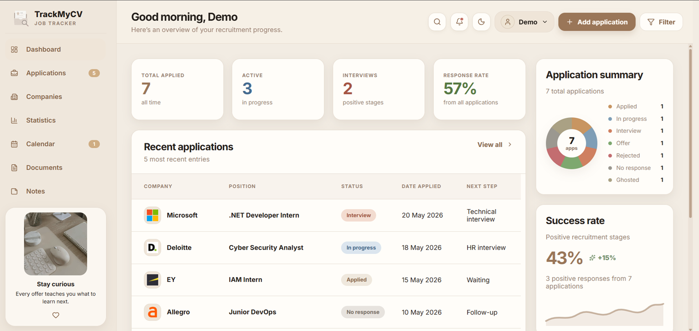
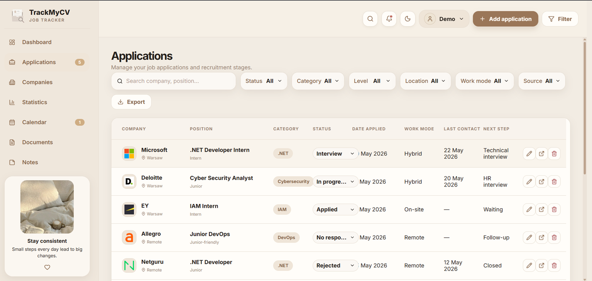
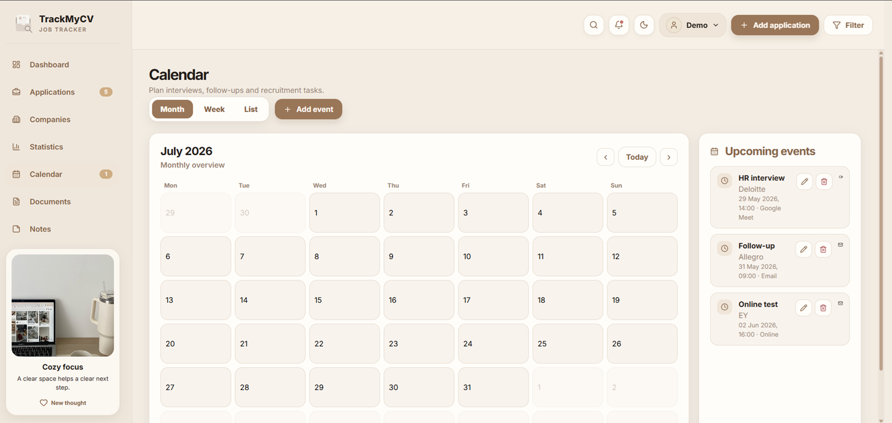
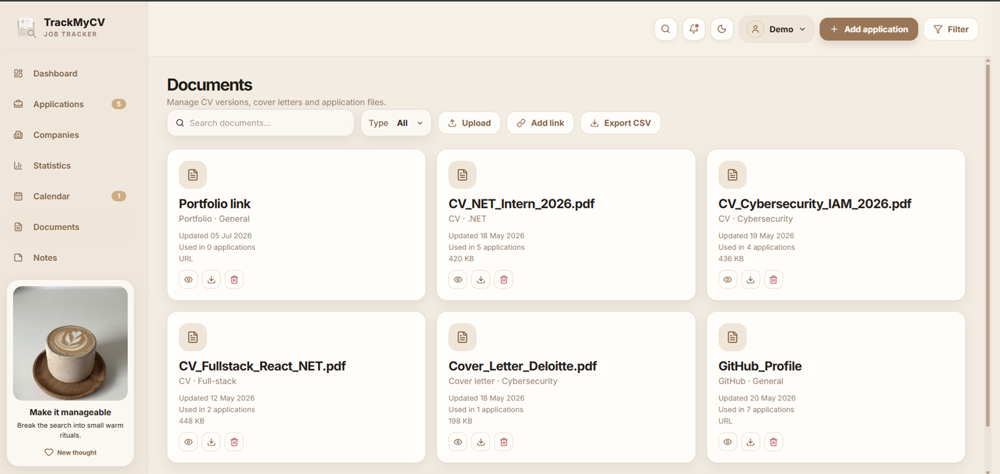
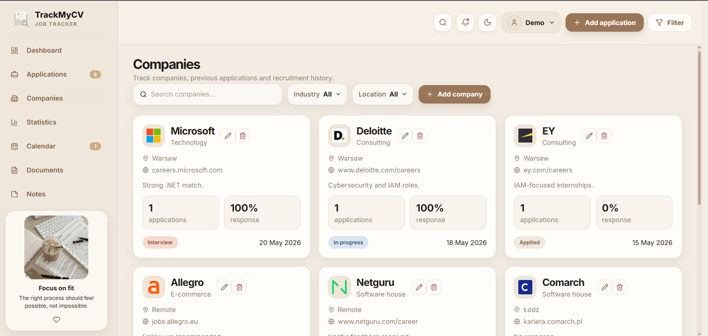
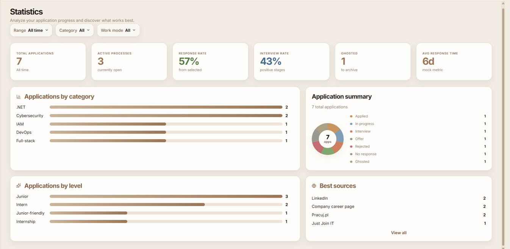
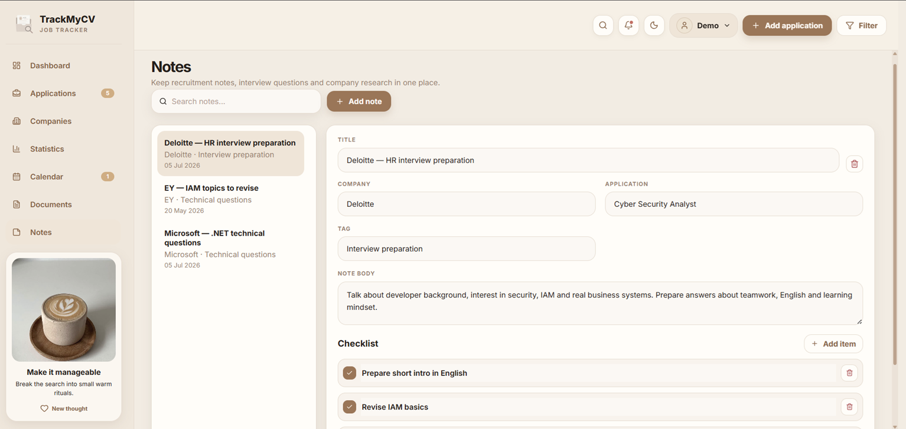
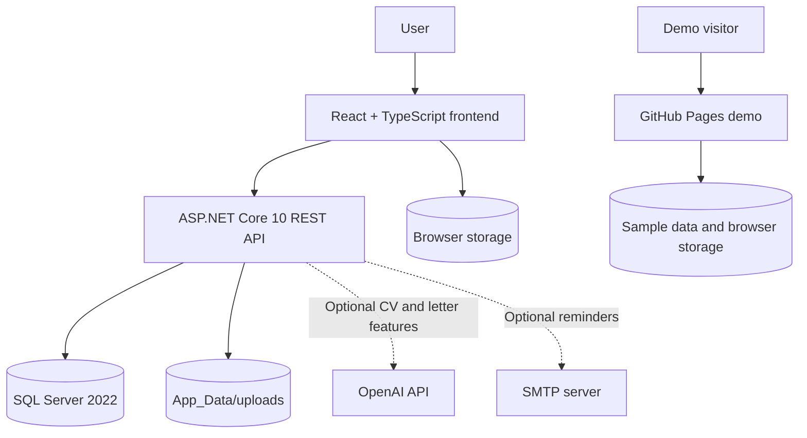

<p align="center">
  
</p>

<h1 align="center">TrackMyCV</h1>

<p align="center">
  <strong>Track applications, organize recruitment materials, and prepare for interviews in one workspace.</strong>
</p>

<p align="center">
  
  <a href="https://avuii.github.io/TrackMyCV/">
    
  </a>
  <a href="https://github.com/Avuii/TrackMyCV/actions/workflows/deploy.yml">
    
  </a>
</p>

<p align="center">
  
  
  
  
  <br />
  
  
  
  <br />
  
  
  
</p>

<p align="center">
  <a href="https://avuii.github.io/TrackMyCV/"><strong>Open Demo</strong></a>
  &nbsp;&middot;&nbsp;
  <a href="docs/local-development.md">Local Development Guide</a>
  &nbsp;&middot;&nbsp;
  <a href="https://github.com/Avuii/TrackMyCV/issues">Report an Issue</a>
</p>

---

## Application Preview

| Dashboard | Applications |
|:---:|:---:|
|  |  |

| Calendar | Documents |
|:---:|:---:|
|  |  |

<details>
<summary><strong>More screenshots</strong></summary>

| Companies | Statistics | Notes |
|:---:|:---:|:---:|
|  |  |  |

</details>

## Table of Contents

- [Overview](#overview)
- [Key Features](#key-features)
- [Technology Stack](#technology-stack)
- [Architecture](#architecture)
- [Getting Started](#getting-started)
- [Configuration & API](#configuration--api)
- [Testing & Security](#testing--security)
- [Project Status & Roadmap](#project-status--roadmap)
- [License](#license)
- [Author](#author)

## Overview

**TrackMyCV** is a full-stack recruitment management application designed for people handling multiple job applications, interviews, documents, and employer contacts at the same time.

It brings application tracking, recruitment analytics, interview scheduling, company research, and CV management together in one workspace. Optional AI features support CV feedback, job matching, and cover-letter preparation.

> [!IMPORTANT]
> **The GitHub Pages demo and the full application are different environments.** The demo uses sample data, simulated sign-in, and browser storage. The locally running full application uses an ASP.NET Core API and SQL Server for account sessions, applications, calendar events, and document metadata. Some workspace settings, company profiles, notes, and preferences still rely on browser storage.

## Key Features

| Area | Capabilities | Storage / availability |
|---|---|---|
| **Application Tracking** | Create and manage applications, recruitment stages, next steps, search, filters, CSV import/export | Full application API |
| **Dashboard & Analytics** | Application statistics, recruitment progress, and visual summaries | Based on saved applications |
| **Recruitment Calendar** | Month, week, and day views; interviews, deadlines, time ranges, locations, and meeting links | Full application API |
| **Documents** | CV files, cover letters, links, categories, metadata, archives, and downloads | SQL Server metadata + API file storage |
| **Companies & Notes** | Employer profiles, research, checklists, attachments, and preparation notes | Browser storage in the full app |
| **AI Assistance** | General CV review, job-match review, review history, and editable cover letters with PDF output | Optional OpenAI integration |
| **Email Notifications** | Interview, deadline, and follow-up reminders; weekly and monthly summaries; test email | Requires SMTP configuration |
| **AI Job Scout** | Live Arbeitnow listings, preference matching, saved and ignored offers, search history, and in-app notifications | Manual and scheduled searches through the API |
| **Personalization** | Light/dark/system themes, accent colors, density, animation settings, and responsive layouts | Full application |

> [!NOTE]
> Job Scout searches the public [Arbeitnow](https://www.arbeitnow.com/) Europe and UK feeds. Turn on a schedule in **AI Tools → Job Scout** to receive in-app notifications for new matches. Scheduled searches run while the API is online.

## Technology Stack

| Layer | Technologies |
|---|---|
| **Frontend** | React, TypeScript, Vite, CSS, Lucide React |
| **Backend** | C#, ASP.NET Core 10, REST API |
| **Data Access** | Entity Framework Core 10 |
| **Database** | Microsoft SQL Server 2022 |
| **Local Infrastructure** | Docker Compose |
| **AI & Documents** | OpenAI API, LaTeX / `pdflatex` |
| **Notifications** | SMTP |
| **Demo & Deployment** | Separate Vite demo, GitHub Pages, GitHub Actions |

## Architecture

The full application separates the React interface, ASP.NET Core API, and persistent data. External AI and email services are optional; the published demo runs independently of the backend.



### Repository Structure

```text
TrackMyCV/
├── frontend/                 # Full React application
├── backend/                  # ASP.NET Core API and application layers
├── demo/                     # Standalone interactive GitHub Pages demo
├── docs/                     # Screenshots and development guide
├── scripts/                  # Local development launcher
├── .github/workflows/        # Demo build and Pages deployment
├── .env.example              # Optional integration settings
├── docker-compose.yml       # SQL Server and API services
└── README.md
```

Uploaded files are stored by the API under `backend/TrackMyCV.Api/App_Data/uploads`, while file metadata is stored in SQL Server. The API applies Entity Framework Core migrations automatically in Development.

## Getting Started

### Prerequisites

- **Node.js 22.12 or newer** and npm
- **.NET 10 SDK**
- **Docker** with Linux containers enabled for SQL Server
- **PowerShell** for the commands below

### Installation

Run the following commands from a PowerShell terminal:

```powershell
git clone https://github.com/Avuii/TrackMyCV.git
cd TrackMyCV

Copy-Item backend/TrackMyCV.Api/appsettings.example.json backend/TrackMyCV.Api/appsettings.json
Copy-Item .env.example .env

npm install --prefix frontend
npm run dev
```

The development launcher starts the SQL Server container, the backend, and the frontend.

| Service | Local address |
|---|---|
| **Frontend** | http://localhost:5173 |
| **Backend API** | http://localhost:5228 |
| **Swagger UI** | http://localhost:5228/swagger |

Stop the development process with `Ctrl+C`.

> [!TIP]
> To explore the interface without installing the backend, use the [interactive GitHub Pages demo](https://avuii.github.io/TrackMyCV/). To use an existing SQL Server instance or run the API in Docker, see the [local development guide](docs/local-development.md).

### Alternative: API in Docker

With the `.env` file configured and Docker Desktop running:

```powershell
docker compose up -d --build api
npm --prefix frontend run dev
```

Docker Compose starts SQL Server and the API. To inspect the API logs, run `docker compose logs -f api`. Stop containers with `docker compose stop`.

### Run the Demo Locally

```powershell
npm ci --prefix demo
npm run dev --prefix demo
```

The demo uses sample data and does not require the backend or SQL Server.

## Configuration & API

### Environment Variables

Copy [`.env.example`](.env.example) to `.env` and configure only the integrations you intend to use.

| Variable | Purpose |
|---|---|
| `OPENAI_API_KEY` | Enables AI-assisted CV reviews and cover letters |
| `OPENAI_MODEL` | OpenAI model used by the integration |
| `LATEX_COMPILER` | LaTeX executable used for PDF generation, e.g. `pdflatex` |
| `EMAIL__ENABLED` | Enables or disables email delivery |
| `EMAIL__HOST` / `EMAIL__PORT` | SMTP server and port |
| `EMAIL__ENABLESSL` | SMTP TLS/SSL setting |
| `EMAIL__USERNAME` / `EMAIL__PASSWORD` | SMTP authentication |
| `EMAIL__FROMEMAIL` / `EMAIL__FROMNAME` | Email sender identity |
| `MSSQL_SA_PASSWORD` | SQL Server password for the Docker setup |

The database connection string for a host-run backend is configured in `backend/TrackMyCV.Api/appsettings.json`. For the Docker API, Compose supplies the connection string.

> [!WARNING]
> The sample database password and connection settings are intended for local development only. Replace default credentials before exposing services outside a trusted local environment. Keep `.env`, `appsettings.json`, and other files containing secrets out of version control.

### Optional Integrations

**OpenAI:** Add `OPENAI_API_KEY` to `.env` to enable CV reviews and cover-letter generation. The API extracts text from supported PDF, DOCX, TXT, and RTF documents and sends relevant content to OpenAI. Image-only PDFs require a text-based version. PDF cover-letter rendering needs a LaTeX compiler; `pdflatex` is included in the API Docker image.

**Email:** Set `EMAIL__ENABLED=true` and provide SMTP configuration. Enter a recipient address in the application's notification settings and use the test-email action to verify delivery.

### API Reference

The backend provides authenticated recruitment management endpoints. The following authentication routes are implemented:

| Method | Endpoint | Purpose |
|---|---|---|
| `POST` | `/api/auth/register` | Create an account |
| `POST` | `/api/auth/login` | Sign in |
| `GET` | `/api/auth/me` | Retrieve the current user |
| `POST` | `/api/auth/logout` | Revoke the current session |

The API also supports application and calendar management, document storage, and optional AI and notification workflows. See [Swagger UI](http://localhost:5228/swagger) when the backend is running for the available routes and request schemas.

## Testing & Security

### Build Verification

Run the full-stack build and automated checks:

```powershell
npm ci --prefix frontend
npm run build --prefix frontend
dotnet test backend/TrackMyCV.slnx --configuration Release
```

The [CI workflow](.github/workflows/ci.yml) runs these checks on pushes and pull requests. The HTTP integration tests use isolated in-memory databases and temporary upload directories. AI, PDF rendering, and email delivery use test substitutes.

The [GitHub Pages deployment workflow](.github/workflows/deploy.yml) builds and publishes the demo.

### Security & Data Handling

- **Authentication:** The full backend implements email/password registration, sign-in, and sign-out with database-backed sessions.
- **Credential handling:** Passwords and session tokens are stored as hashes; authentication routes include input validation and rate limiting.
- **Data storage:** Account-related records, applications, calendar events, and document metadata use SQL Server. Uploaded files are stored by the API.
- **Workspace data:** Company profiles, notes and attachments, and job preferences synchronize through the API. Appearance settings are stored in the browser.
- **External processing:** When AI features are enabled, relevant extracted document text is transmitted to OpenAI.

> [!IMPORTANT]
> The hosted demo uses simulated sign-in and client-side browser storage. It is a product showcase, not an authenticated production environment. Avoid entering sensitive personal or recruitment information into the demo.

## Project Status & Roadmap

**Current stage:** Active development. The local full-stack application and CI checks are available. Production deployment is pending.

### Implemented

- [x] User registration, sign-in, sign-out, and database-backed sessions.
- [x] Application tracking, recruitment statuses, filtering, search, and CSV import/export.
- [x] Dashboard metrics and recruitment statistics.
- [x] Calendar with month/week/day views and API-backed events.
- [x] Document uploads, links, metadata, archiving, and downloads.
- [x] API-backed company profiles, notes with checklists and attachments, and job preferences.
- [x] Responsive layout and appearance customization.
- [x] Configurable interview, deadline, and follow-up email reminders, plus weekly/monthly summaries and test emails (SMTP required).
- [x] CV review, job-match review, and saved review history (OpenAI required).
- [x] AI-assisted cover-letter editing, PDF preview, download, and saving to Documents (OpenAI and LaTeX required).
- [x] Live Job Scout listings, preference matching, saved and ignored offers, persisted search history, and scheduled in-app notifications.
- [x] Docker Compose setup, EF Core development migrations, and automated GitHub Pages demo deployment.

### Planned Improvements

**AI Job Scout**

- [x] Integrate a permitted job API, RSS feed, or company careers source for real offers.
- [x] Normalize and deduplicate offers, match them to preferences, and exclude already tracked vacancies.
- [x] Persist search results, saved/ignored offers, and history; introduce scheduled searches and notifications.

**Connected Recruitment Workspace**

- [x] Move company profiles, notes/attachments, and job preferences to API-backed storage for cross-device access.
- [x] Connect applications with documents by ID, companies, notes, and calendar deadlines.
- [x] Add application activity timelines, document usage history, in-app notifications, and follow-up suggestions.
- [x] Apply user-configured follow-up intervals and verify timing and delivery against a local SMTP receiver.
- [ ] Verify delivery to a real inbox with the configured SMTP account.

**Quality & Deployment**

- [x] Add automated tests for authentication, application CRUD, document uploads, calendar synchronization, reminders, and AI workflows.
- [x] Update the backend dependency flagged during the build audit (`System.Security.Cryptography.Pkcs` 9.0.4).
- [x] Commit a frontend lockfile and pin dependencies for reproducible builds.
- [ ] Deploy the full frontend, API, and database with persistent uploads, backups, health checks, and monitoring.

**User Experience & Preparation**

- [x] Add CV-to-job comparisons, reusable templates, and interview preparation collections.
- [x] Add AI interview questions, job-description summaries, and application-specific suggestions.
- [x] Improve mobile workflows, accessibility, onboarding, loading/error states, and dashboard customization.

## License

This project is licensed under the [MIT License](LICENSE).


---

## Author

Created and maintained by **[Avuii](https://github.com/Avuii)**.
